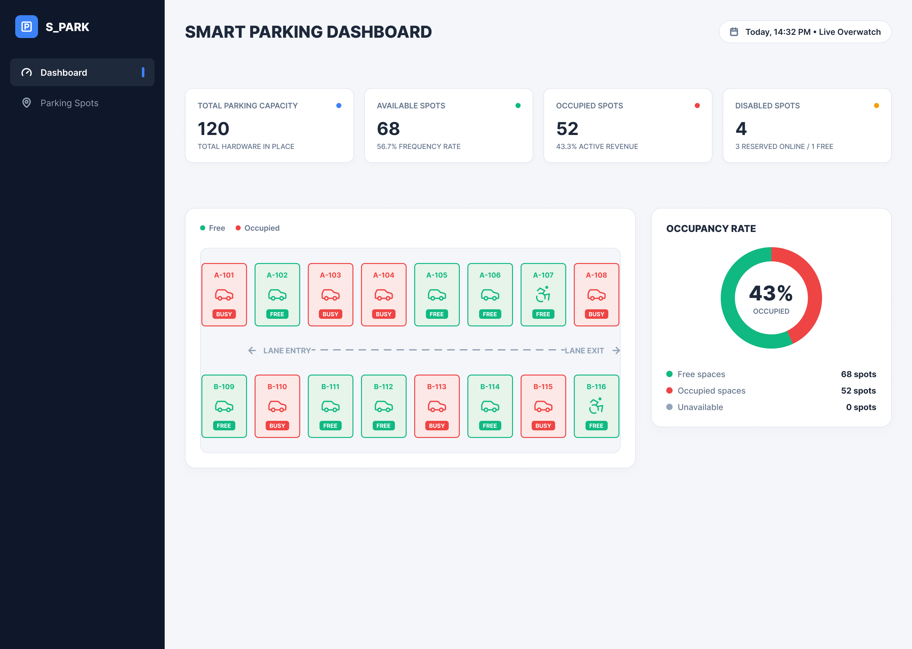

# Smart Parking IoT: Sistema di Monitoraggio dei Posti Auto

## Descrizione del Progetto

Questo progetto realizza un sistema IoT per il monitoraggio di un parcheggio composto da quattro posti auto. Il sistema acquisisce la distanza tra ciascun sensore e l'eventuale veicolo, determina lo stato del posto e rende disponibili le informazioni tramite un'interfaccia Web.

Progetto svolto da Andrea Tonini e Assmaa Matouk, A.A. 2026/2027

Il sistema utilizza:

- Una **scheda ESP32**, programmata in MicroPython, per acquisire le misure e inviare i dati.
- 4 **sensori a ultrasuoni HC-SR04**, uno per ciascun posto auto.
- Un **display OLED SSD1306**, collegato tramite I²C, per mostrare le informazioni relative alle letture.
- 8 **LED di segnalazione**, 4 verdi e 4 rossi presenti nello schema del circuito.
- Il **protocollo MQTT**, per trasmettere le letture dall'ESP32 al broker pubblico **EMQX**.
- Un **backend Node.js/Express e TypeScript**, che riceve i messaggi MQTT, gestisce le API REST e comunica con il database.
- Un **database MySQL**, che conserva le informazioni dei posti auto.
- Un'**interfaccia Web sviluppata con Vue.js**, per visualizzare lo stato del parcheggio.

L'obiettivo è mostrare come sensori, microcontrollore, protocolli di comunicazione, backend, database e interfaccia Web possano collaborare all'interno di un unico sistema IoT.

## Funzionalità Principali

- **Monitoraggio dei posti auto:** acquisizione periodica della distanza tramite i quattro sensori HC-SR04.
- **Rilevamento dell'occupazione:** classificazione del posto come libero o occupato in base al colore del led illuminato deciso alla distanza misurata e alla soglia impostata nel firmware ESP32.
- **Comunicazione MQTT:** pubblicazione delle letture su topic distinti, uno per ciascun posto auto.
- **Aggiornamento del database:** il backend riceve i messaggi MQTT e aggiorna lo stato e la distanza registrati per il posto corrispondente.
- **Visualizzazione OLED:** visualizzazione dell'identificativo del posto, della distanza rilevata e dello stato calcolato.
- **Dashboard Web:** riepilogo della capacità del parcheggio, dei posti liberi e occupati e dei posti riservati alle persone con disabilità.
- **Mappa dei posti auto:** rappresentazione dei posti suddivisi per fila e colorati in base allo stato.
- **Dettaglio dei posti:** pagina dedicata con tipologia, stato, distanza rilevata e orario dell'ultimo aggiornamento.
- **API REST:** endpoint per leggere i posti auto, registrare una lettura e modificare la soglia memorizzata nel database.

## Architettura del Sistema

Il flusso dei dati è organizzato nel seguente modo:

1. I sensori HC-SR04 collegati all'ESP32 rilevano la distanza dall'eventuale veicolo.
2. Il firmware ESP32 calcola lo stato del posto e prepara un messaggio JSON.
3. L'ESP32 pubblica il messaggio sul broker MQTT EMQX, utilizzando un topic dedicato al posto auto.
4. Il backend Node.js si sottoscrive ai topic MQTT e riceve le letture.
5. Il backend aggiorna la tabella `parking_spots` nel database MySQL.
6. Il frontend Vue.js interroga periodicamente l'API REST `GET /api/spots` e aggiorna le informazioni mostrate nella dashboard.


## Backend e Database

Il backend è sviluppato con **Node.js**, **Express** e **TypeScript**. La gestione della comunicazione MQTT è collocata in `backend/src/utils/broker.ts`, mentre `backend/src/app.ts` configura il server, registra le rotte REST e avvia il client MQTT.

Il database `smart_parking` contiene la tabella `parking_spots`, che memorizza:

- `id`: identificativo del posto auto;
- `status`: stato del posto (`FREE` oppure `BUSY`);
- `current_distance`: ultima distanza ricevuta, in centimetri;
- `threshold_cm`: soglia associata al posto;
- `spot_type`: tipologia del posto (`standard` oppure `disabled`);
- `last_update`: data e ora dell'ultimo aggiornamento del record.

## Frontend

L'interfaccia Web è sviluppata con **Vue 3**, **TypeScript** e **Vite**. Le richieste al backend sono effettuate tramite Axios; durante lo sviluppo, Vite inoltra le richieste che iniziano con `/api` al server backend su `localhost:3000`.

L'applicazione comprende due pagine principali:

- **Dashboard (`/`):** mostra il numero totale dei posti, i posti liberi e occupati, i posti riservati alle persone con disabilità, una rappresentazione grafica dei posti e il tasso di occupazione.
- **Posti auto (`/spots`):** mostra una tabella con identificativo, tipologia, stato, distanza e ultimo aggiornamento di ciascun posto.

I dati della dashboard vengono richiesti al backend ogni due secondi.

## Mockup 
I mockup qui sotto mostrano come si presenta l'interfaccia Web del progetto, con la dashboard principale e la visualizzazione dei posti auto


.png)
## Configurazione e Avvio

### Requisiti

- Node.js e npm.
- MySQL.
- Un browser Web.
- Wokwi per eseguire la simulazione ESP32, oppure una scheda ESP32 compatibile con MicroPython.

### 1. Configurazione del database consigliata

Dopo aver avviato XAMPP importare il file **smart_parking.sql** in http://localhost/phpmyadmin/ 

Verificare inoltre le credenziali configurate in `backend/src/utils/db.ts` e modificarle in base alla propria installazione MySQL.

### 2. Avvio del backend

Da un terminale, entrare nella cartella `backend` ed eseguire:

```bash
cd backend
npm install
npm run dev
```

Il server Express viene avviato sulla porta `3000` e avvia anche il client MQTT.

### 3. Avvio del frontend

Aprire un secondo terminale, entrare nella cartella `frontend` ed eseguire:

```bash
cd frontend
npm install
npm run dev
```

Vite avvia il server di sviluppo; normalmente l'interfaccia è disponibile all'indirizzo:

```text
http://localhost:5173
```

Il proxy configurato in Vite inoltra le richieste `/api` al backend su `http://localhost:3000`.

### 4. Avvio della simulazione ESP32

Aprire il progetto Wokwi al link https://wokwi.com/projects/478243873950478337 (oppure aprire un nuovo progetto e copiare i file presenti nella cartella `ESP32`), avviare la simulazione e verificare dal monitor seriale la connessione Wi-Fi, la connessione MQTT e le letture dei quattro sensori.

Il firmware utilizza la rete Wi-Fi `Wokwi-GUEST`, prevista per la simulazione Wokwi. Per utilizzare una rete diversa o una scheda fisica è necessario configurare le credenziali Wi-Fi nel file `ESP32/main.py`.
